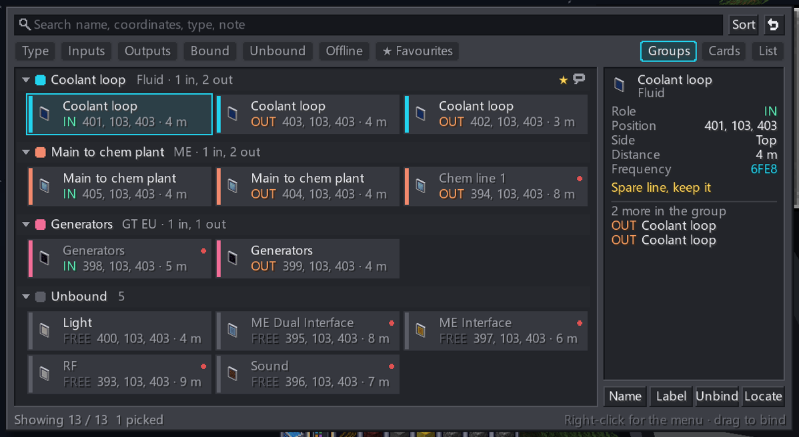
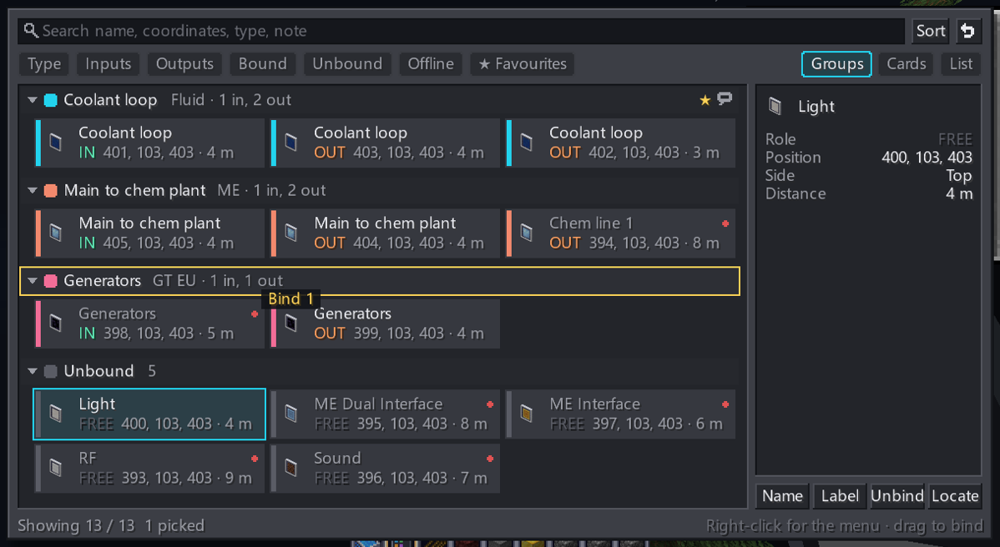
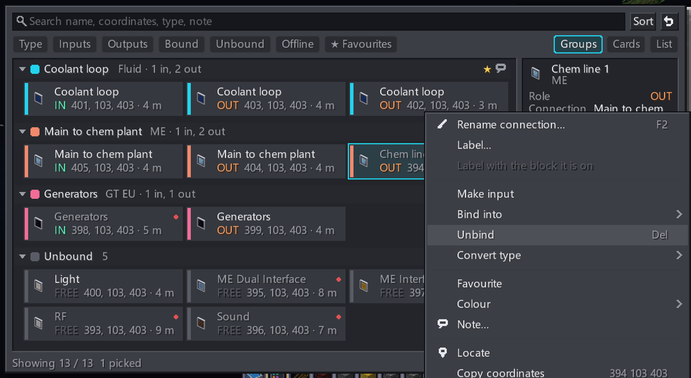
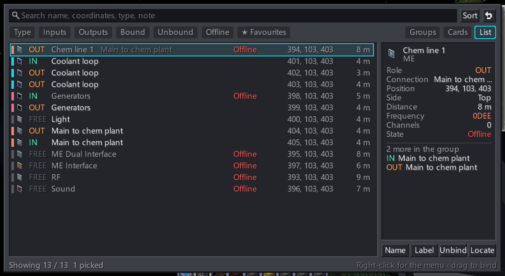

# ETO P2P

[中文](README.zh-CN.md)

A card for Applied Energistics 2 on GT New Horizons. It lists every P2P tunnel of a network on one screen and binds them by drag and drop.



## What it does

- Shows the tunnels as connections, cards or rows. Search finds names, coordinates, types and notes.
- Binds by drag and drop: drop tunnels on an input or on a connection. A tunnel of another type is converted.
- Names connections, labels single tunnels, and marks connections with a favourite, a colour or a note.
- Unbinds, converts and swaps the input, for one tunnel or many. Undo goes back 20 steps.
- Points a tunnel out in the world.

| Drag to bind | Menu | List |
| --- | --- | --- |
|  |  |  |

## Use

| Action | Result |
| --- | --- |
| Use the card on a network | Opens the screen |
| Use it on air | Opens the last network |
| Sneak-use on a tunnel | Picks it as the input |
| Use on another tunnel | Binds it as an output of the picked input |
| Sneak-use on air | Clears the picked input and the locate highlight |

On the screen: Ctrl-click adds to the selection, Shift-click selects a run, dragging on empty room draws a box. F2 renames, Del unbinds, Ctrl+Z undoes.

Locate ends 3 seconds after you get within 3 blocks of the tunnel, after 30 seconds at the latest, and when the screen opens again.

The card is crafted from BetterP2P's advanced memory card, and back.

## Requirements

Client and server need the mod. It depends on Applied Energistics 2 (GTNH), ModularUI 2 and Forgelin. Changing a network needs build permission on its security terminal.

## Build

```sh
uv run tools/build.py
```

The jar is written to `build/libs`. The build needs JDK 25, set with `ETO_BUILD_JDK`.

## Testing without hands

With `-Detop2p.dev=true` the server has the `etop2p_dev` command and the client reads mouse and key input from a file. See `DevCommand.kt` and `DevInput.kt`.
