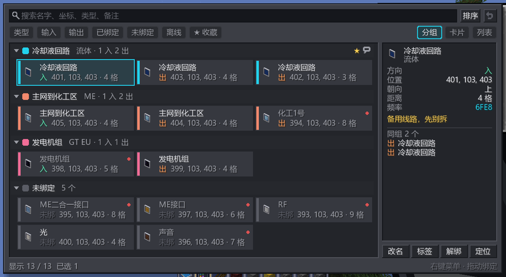
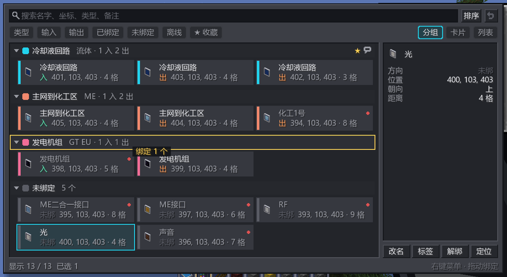
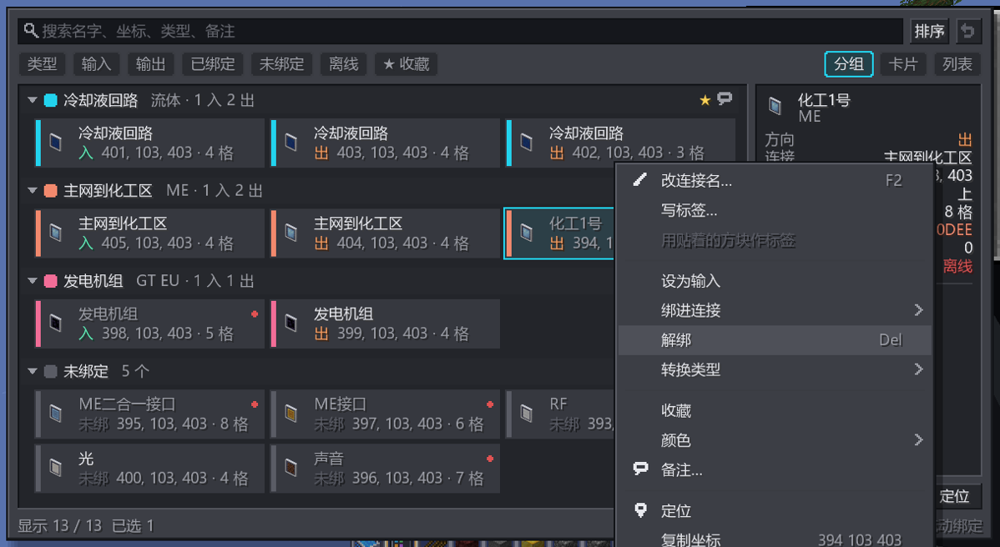
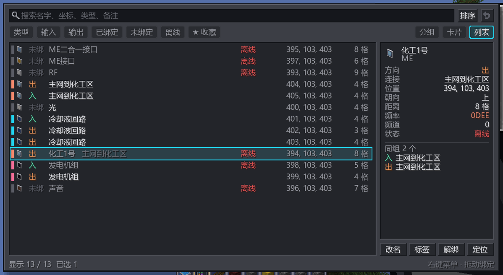

# ETO P2P

[English](README.md)

GT New Horizons 里 Applied Energistics 2 用的一张卡：一个界面列出网络里的全部 P2P，拖一下就绑定。



## 功能

- 按连接分组、卡片、列表三种视图。搜索支持名字、拼音、坐标、类型和备注。
- 拖动绑定：把 P2P 拖到输入端或一条连接上。类型不同会自动转换。
- 给连接改名，给单个 P2P 写标签，给连接加收藏、颜色和备注。
- 解绑、转换类型、换输入端，可以一次改多个。撤销最多 20 步。
- 在世界里高亮指出 P2P。

| 拖动绑定 | 菜单 | 列表 |
| --- | --- | --- |
|  |  |  |

## 用法

| 操作 | 结果 |
| --- | --- |
| 拿卡右键网络 | 打开界面 |
| 右键空气 | 打开上次的网络 |
| 潜行右键 P2P | 选为输入 |
| 右键别的 P2P | 绑成已选输入的输出 |
| 潜行右键空气 | 清除已选输入和定位高亮 |

界面里：Ctrl 点击加选，Shift 点击连选，空白处拖动框选。F2 改名，Del 解绑，Ctrl+Z 撤销。

定位在你走到 P2P 3 格内之后 3 秒结束，最长 30 秒，再打开界面时也会结束。

卡用 BetterP2P 的高级内存卡合成，也能换回去。

## 依赖

客户端和服务端都要装。依赖 Applied Energistics 2（GTNH）、ModularUI 2 和 Forgelin。改动网络需要安全终端的建造权限。

## 构建

```sh
uv run tools/build.py
```

产物在 `build/libs`。构建需要 JDK 25，用 `ETO_BUILD_JDK` 指定。

## 免手动测试

加 `-Detop2p.dev=true` 后，服务端有 `etop2p_dev` 命令，客户端从文件读取鼠标和键盘输入。见 `DevCommand.kt` 和 `DevInput.kt`。
